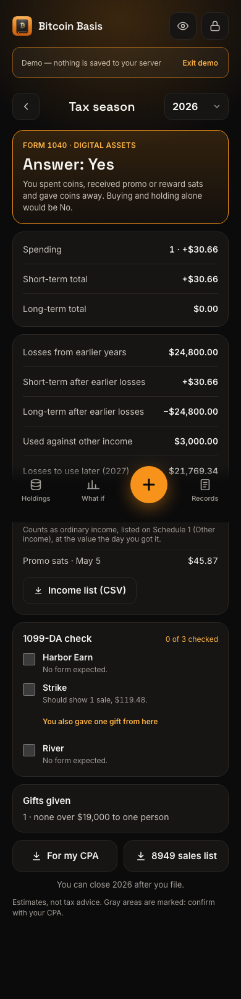
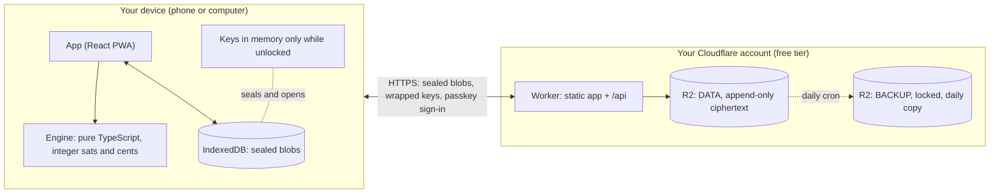
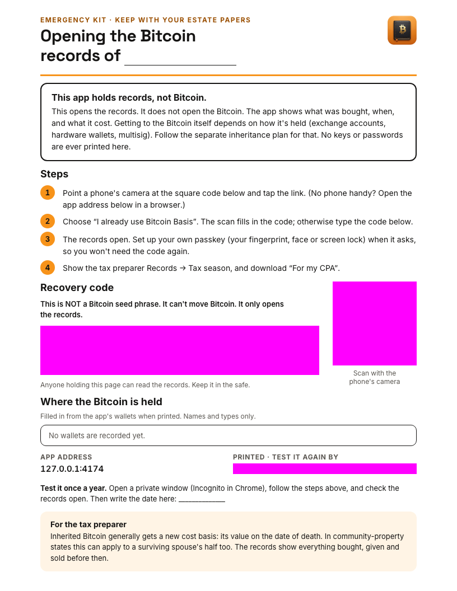

# Bitcoin Basis

**Know what your Bitcoin cost.**

A self-hosted, local-first, end-to-end encrypted cost-basis and records app for Bitcoin only. Your records live on your devices, sync through a tiny server you own, and are readable by nobody else, including that server.

**[Try the live demo](https://bitcoin-basis.ryanwillmore.workers.dev/demo)**: made-up data, no sign-up, nothing saved.

<!-- VIDEO: in GitHub's web editor, drag bitcoin-basis-demo.mp4 onto the blank line below this comment. GitHub uploads it and inserts a link that plays inline. Then delete this comment. -->


<p>
  
  
  
</p>

All screenshots use the built-in synthetic demo data.

> Not tax advice. Bitcoin Basis keeps records and estimates tax. Check the numbers with a tax professional.

## Highlights

- **End-to-end encrypted with passkeys.** A fingerprint or face unlock opens your records through the WebAuthn PRF extension. The server stores only padded ciphertext, has no code path that deletes or overwrites, and copies everything daily to a locked backup bucket.
- **Local-first.** An installable app that works offline and syncs a phone and a computer through a small server you own.
- **A tax engine you can check.** Pure TypeScript with integer sats and cents and no runtime dependencies. 610 tests with 100% coverage enforced in CI, a 93% mutation score, and an exact match with an independent reference on 2,800 random cases.
- **Built to current IRS rules.** Coins are tracked wallet by wallet (Rev. Proc. 2024-28), every sale remembers exactly which lots it used, and edge cases such as gifts below cost, frozen platforms, loans and closed years are covered by tests.
- **Verifiable.** Each release publishes its build hashes, and a daily job rebuilds the app from source and compares it with the live site.
- **Built by directing AI agents, then checking their work.** Adversarial reviews, differential tests and real-device checks; the mistakes they caught are listed in [how this was built with AI](docs/how-this-was-built-with-ai.md).

## Is it for you?

If you hold your own coins, nobody sends you a tax statement, yet the IRS still wants the cost, date and holding period of every coin you sell, spend or give away. Bitcoin Basis is for one person or a household holding Bitcoin in more than one place (exchanges, hardware wallets, multisig) who wants those records private and under their own control, not in a cloud tax service.

- **Setup needs a computer, once.** A computer with Node 24, the `gh` CLI, and free GitHub and Cloudflare accounts. [SELF-HOSTING.md](SELF-HOSTING.md) walks through it step by step. After that, a phone on its own is enough.
- **Free to run.** Everything fits in Cloudflare's free tier.
- **Passkeys.** Each device needs a passkey that supports PRF: current iPhone, iPad, Mac, Android and Windows 11, in Safari or Chrome, or a password manager whose passkeys support PRF.
- **What it is not.** Not a wallet (it cannot move or unlock Bitcoin), not for other coins, and not tax advice.

## What it does

- **Holdings:** what your Bitcoin is worth, average cost, unrealized gain, a daily price chart for three years against your average cost (with the high marked), a stack by year, and balances per wallet. Every lot is tagged Documented, Reconstructed, Estimated or Unknown, so you can see how well each cost is backed up.
- **Log:** buy, receive (income, gift, inherited, payout from a frozen platform), move between wallets (with the fee), sell or spend, give, and record lost coins.
- **Wallet by wallet:** coins are tracked per wallet, as the 2025 IRS rules ask (Rev. Proc. 2024-28). Saved lot choices: every sale remembers exactly which lots it used (a lot is Bitcoin you got at one time for one cost, usually one purchase), so adding an older purchase later never changes a past sale.
- **Sell and Borrow planners:** compare oldest first with lowest tax (lots used, short- and long-term gain, tax this adds, losses left for next year). Borrow shows loan-to-value, margin-call and liquidation prices, and the tax a liquidation would add.
- **Tax season:** gains, losses, income and gifts for a year, the 1040 digital-asset answer, and CSV downloads (Form 8949-style, income) for your preparer. Federal tables for 2025 to 2027; state as a flat rate, no tax, or a custom rate.
- **Records:** entries with history (edits and deletes are new entries, nothing is overwritten), close a year, import your lots from a spreadsheet (CSV), and export everything as a spreadsheet or a full backup file.
- **Settings** (the gear at the top, or Settings in the sidebar): taxes, security and devices, the emergency kit, and app options.
- **Frozen or failed platform:** close-out with the loss, and later payouts as recovery gains.
- **Loans:** Bitcoin bought with borrowed money (for example a HELOC). Link purchases to draws, log payments and rate changes, check the balance against a statement, and see what the loan bought, what is still held, and the break-even price including interest paid.
- **Retirement accounts:** log what an IRA bought to see each purchase's cost, worth now and gain, plus an All Bitcoin total (taxable and retirement together). Retirement coins never enter tax math.
- **Emergency kit:** a one-page printout for your estate papers: the recovery code, how to open the records, and where the Bitcoin is held (wallet names only). The app reminds you to test it once a year.
- **Hide amounts** (your choice, off by default), installable on a phone, offline after the first load.
- **Try the demo:** on the first screen, "Try the demo" loads synthetic data, or open `/demo` on your app's address (a link you can share). Once set up, the lock screen has "Show the demo" too, to show someone on your own phone. Made-up data, kept only in memory and gone when you close it. Import and restore are off.

The browser talks only to your own Worker. The Worker fetches the public BTC price (history rounded to the hour) from mempool.space, or from your own `MEMPOOL_URL`, and forwards nothing about you. When mempool fails, the live price comes from Coinbase's public spot price instead (`COINBASE_URL`, `off` to skip it), again with nothing about you.

## How it works



- **Keys.** A random data key (AES-256-GCM) seals your entries. A passkey on each device unlocks it through the WebAuthn PRF extension. A 30-character recovery code (not a seed phrase) opens it on a new device. Rotating the recovery code starts a new data-key epoch, so the old code stops working for new data.
- **Server.** The Worker verifies passkeys and stores sealed, padded blobs "only if new". It has no code path that deletes or overwrites. It never sees a key or plaintext.
- **Engine.** `engine/` turns the entries into lots, gains and plans. It does no I/O.

Details: [sync protocol](docs/sync-protocol.md), [engine spec](docs/engine-spec.md), [security](SECURITY.md), [decisions](docs/decisions/).

<p>
  
  
</p>

<a href="docs/screenshots/kit.png"></a>

Desktop: [Holdings](docs/screenshots/holdings-desktop.png), [Sell](docs/screenshots/sell-desktop.png), [Tax season](docs/screenshots/tax-season-desktop.png).

## Quick start

On a computer, with a free Cloudflare account, a GitHub account, Node 24 and the `gh` CLI, follow [SELF-HOSTING.md](SELF-HOSTING.md): fork, run `npm run setup`, add three GitHub settings, push. It is written so you can hand it to an AI agent. Deploys run only from GitHub Actions, after CI passes.

To work on the code:

```sh
npm ci --ignore-scripts
npm run dev          # app on http://localhost:5173 (try the demo; no server needed)
npm run check        # typecheck, lint, all unit tests with the engine coverage gate
```

See [AGENTS.md](AGENTS.md) and [CONTRIBUTING.md](CONTRIBUTING.md).

## Tech stack

- **App:** React 19, TypeScript, Vite, Tailwind CSS 4, React Router, WebCrypto, IndexedDB, a service worker. Runtime dependencies: React, React Router, `qrcode-generator` and two font packages.
- **Engine:** TypeScript with no runtime dependencies.
- **Server:** one Cloudflare Worker (static assets plus `/api`), two private R2 buckets, `@simplewebauthn/server`.
- **Tests and CI:** Vitest, fast-check, Playwright with axe, GitHub Actions, CodeQL, gitleaks.

## Quality

Counts from `npm run check` and `npx playwright test --list` at v1.0.0 plus the changes since:

| What | Result |
|---|---|
| Unit and integration tests (Vitest) | 1,169 in 94 files: engine 610, app 440, worker 81 (runs in `workerd` with local R2), tools 38 |
| Engine coverage | 100% of statements, branches, functions and lines, enforced in CI |
| Mutation testing (Stryker) | 93% of engine mutants killed |
| End-to-end (Playwright, phone 390 px and desktop 1440 px) | 300 test runs in 28 files; CI runs all but the visual ones. An axe accessibility check on every screen and sheet, and a test build with a fake server and authenticator that the production bundle is checked never to contain |
| Visual baselines | 24 runs, macOS only (fonts differ per OS), run locally |
| Live tests | Against a real throwaway deployment: two devices syncing, recovery and code rotation, a check that the bucket holds only ciphertext, and a backup restore drill |
| Property tests | fast-check over thousands of random histories: sats and cost always balance, saved sales never change, entry order doesn't matter, export and import round-trip |
| Tax math | Exact match with an independent Decimal reference on 2,800 random cases; the worked examples in the [engine spec](docs/engine-spec.md) are tests; federal tables checked line by line against the IRS revenue procedures |
| CI | Typecheck, lint, tests, lockfile check, `npm audit`, CodeQL, gitleaks, Playwright; deploys only after CI passes, with SHA-pinned actions |
| Reviews | Independent adversarial reviews: engine accuracy (three rounds), security design (four rounds) and a first-time-user UX audit (65 findings). See [how this was built with AI](docs/how-this-was-built-with-ai.md) |

## Status

v1.0.0, released November 2026 and in use by the author. Build log: [PROGRESS.md](docs/PROGRESS.md); changes: [CHANGELOG.md](CHANGELOG.md).

## License

[MIT](LICENSE). Not tax advice.
