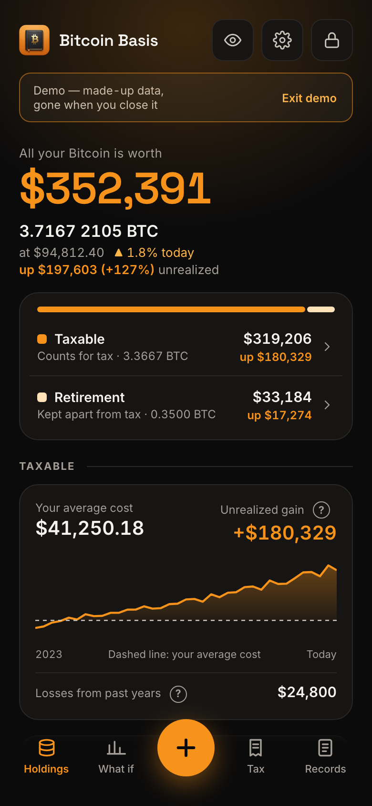
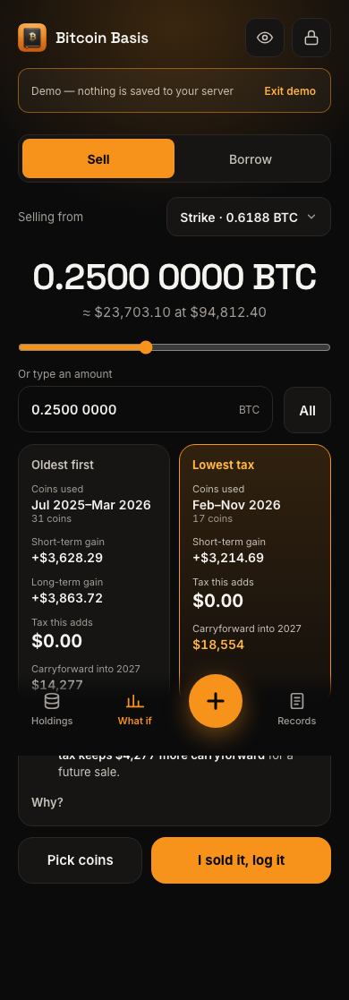
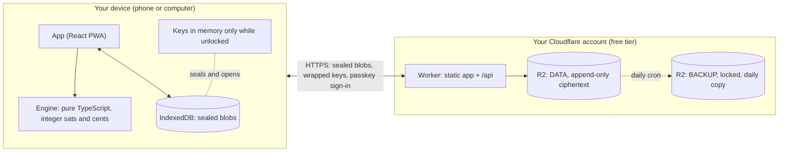
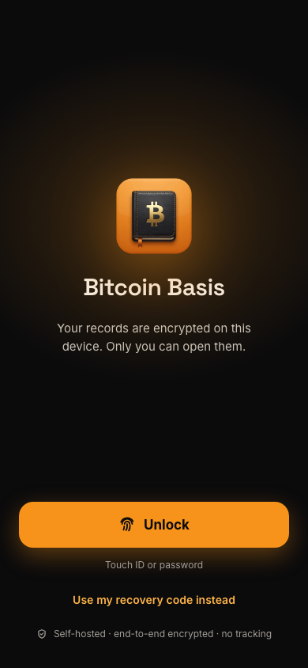
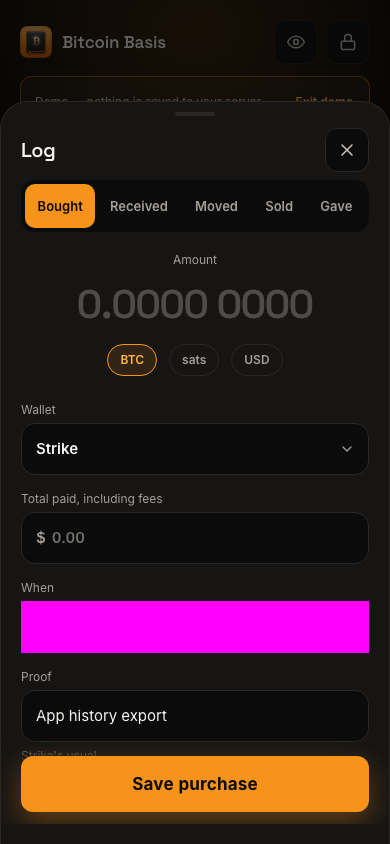

# Bitcoin Basis

**Know what your Bitcoin cost.**

A self-hosted, local-first, end-to-end encrypted cost-basis and records app for Bitcoin only. Your records live on your devices, sync through a tiny server you own, and are readable by nobody else, including that server.

<!-- TODO: 60-second demo GIF (open the app, Try the demo, Holdings, Log a purchase, Sell comparison, Tax season). Save as docs/screenshots/demo.gif and embed here. -->

<p>
  
  
  
</p>

All screenshots use the built-in synthetic demo data.

> Not tax advice. Bitcoin Basis keeps records and estimates tax. Check the numbers with a tax professional.

## Why

- **Self-custody needs records.** If you hold your own coins, nobody sends you a statement. The IRS still wants the cost, date and holding period of every coin you sell, spend or give away.
- **Local-first.** The app works offline. Your records are on your device first; the server is only a mailbox that keeps devices in step.
- **End-to-end encrypted.** Everything is sealed on your device with keys the server never sees. A leaked server or backup shows ciphertext (see [SECURITY.md](SECURITY.md)).
- **Bitcoin only.** One asset, done carefully: integer sats and cents, saved coin choices, and tax math checked against an independent reference.

## What it does

- **Holdings:** what your Bitcoin is worth, average cost, gain on paper, a stack by year, and balances per wallet. Every lot is tagged Documented, Reconstructed, Estimated or Unknown, so you can see how well each cost is backed up.
- **Log:** buy, receive (income, gift, inherited, payout from a frozen platform), move between wallets (with the fee), sell or spend, give, and record lost coins.
- **Wallet by wallet:** coins are tracked per wallet, as the 2025 IRS rules ask (Rev. Proc. 2024-28). Saved coin choices: every sale remembers exactly which lots it used, so adding an older purchase later never changes a past sale.
- **Sell and Borrow planners:** compare oldest first with lowest tax (coins used, short- and long-term gain, tax this adds, losses left for next year). Borrow shows loan-to-value, margin-call and liquidation prices, and the tax a liquidation would add.
- **Tax season:** gains, losses, income and gifts for a year, the 1040 digital-asset answer, and CSV downloads (Form 8949-style, income) for your preparer. Federal tables for 2025 to 2027; state as a flat rate, no tax, or a custom rate.
- **Records:** entries with history (edits and deletes are new entries, nothing is overwritten), close a year, import opening lots from a CSV, and export everything.
- **Settings** (the gear at the top, or Settings in the sidebar): taxes, security and devices, the emergency kit, and app options.
- **Frozen or failed platform:** close-out with the loss, and later payouts as recovery gains.
- **Retirement accounts:** log what an IRA bought to see each purchase's cost, worth now and gain, plus an All Bitcoin total (taxable and retirement together). Retirement coins never enter tax math.
- **Emergency kit:** a printable page with a recovery code and QR that opens your records on a new device, plus a yearly reminder to test it.
- **Hide amounts** (your choice, off by default), installable on a phone, offline after the first load.
- **Try the demo:** on the first screen, "Try the demo" loads synthetic data. Made-up data, kept only in memory and gone when you close it. Import and restore are off.

The browser talks only to your own Worker. The Worker fetches the public BTC price (history rounded to the hour) from mempool.space, or from your own `MEMPOOL_URL`, and forwards nothing about you.

## How it works



- **Keys.** A random data key (AES-256-GCM) seals your entries. A passkey on each device unlocks it through the WebAuthn PRF extension. A 30-character recovery code (not a seed phrase) opens it on a new device. Rotating the recovery code starts a new data-key epoch, so the old code stops working for new data.
- **Server.** The Worker verifies passkeys and stores sealed, padded blobs "only if new". It has no code path that deletes or overwrites. It never sees a key or plaintext.
- **Engine.** `engine/` turns the entries into lots, gains and plans. It does no I/O.

Details: [sync protocol](docs/sync-protocol.md), [engine spec](docs/engine-spec.md), [security](SECURITY.md), [decisions](docs/decisions/).

<p>
  
  
</p>

<a href="docs/screenshots/kit.png"></a>

Desktop: [Holdings](docs/screenshots/holdings-desktop.png), [Sell](docs/screenshots/sell-desktop.png), [Tax season](docs/screenshots/tax-season-desktop.png).

## Quick start

You need a free Cloudflare account, a GitHub account, Node 24 and the `gh` CLI. Follow [SELF-HOSTING.md](SELF-HOSTING.md): fork, run `npm run setup`, add three GitHub settings, push. It is written so you can hand it to an AI agent. Deploys run only from GitHub Actions, after CI passes.

To work on the code:

```sh
npm ci --ignore-scripts
npm run dev          # app on http://localhost:5173 (try the demo; no server needed)
npm run check        # typecheck, lint, all unit tests with the engine coverage gate
```

See [AGENTS.md](AGENTS.md) and [CONTRIBUTING.md](CONTRIBUTING.md).

## Tech stack

- **App:** React 19, TypeScript, Vite, Tailwind CSS 4, React Router, WebCrypto, IndexedDB, a service worker. Runtime dependencies: React, React Router, `qrcode-generator` and two font packages.
- **Engine:** TypeScript with no runtime dependencies.
- **Server:** one Cloudflare Worker (static assets plus `/api`), two private R2 buckets, `@simplewebauthn/server`.
- **Tests and CI:** Vitest, fast-check, Playwright with axe, GitHub Actions, CodeQL, gitleaks.

## Quality

Counts from `npm run check` and `npx playwright test --list`:

| What | Result |
|---|---|
| Unit and integration tests (Vitest) | 710 in 56 files: engine 415, app 209, worker 57 (runs in `workerd` with local R2), tools 29 |
| Engine coverage | 100% of statements, branches, functions and lines (enforced in CI) |
| End-to-end (Playwright, phone 390 px and desktop 1440 px) | 162 test runs in 13 files, 140 in CI. Includes an axe accessibility check on every screen and sheet, and a build with a fake server and authenticator that the production bundle is checked never to contain |
| Visual baselines | 22 runs, macOS only (fonts differ per OS), run locally |
| Live two-device test | `app/e2e-live/two-devices.spec.ts`, against a real deployment, run by hand |
| Property tests | fast-check over thousands of random histories: sats and cost balance, saved sales never change, order independence, export/import round trip |
| Tax math | Matches an independent Decimal reference on 2,800 random cases; worked examples in the [engine spec](docs/engine-spec.md) are tests |
| CI | typecheck, lint, tests, lockfile check, `npm audit`, CodeQL, gitleaks, Playwright |
| Reviews | Independent adversarial reviews of the engine (two rounds), the security design (four rounds) and the UX (65 findings). See [how this was built with AI](docs/how-this-was-built-with-ai.md) |

## Status

Built in steps; see [docs/PROGRESS.md](docs/PROGRESS.md). Security review and a fresh-agent dry run of the self-hosting guide are still open.

## License

[MIT](LICENSE). Not tax advice.
